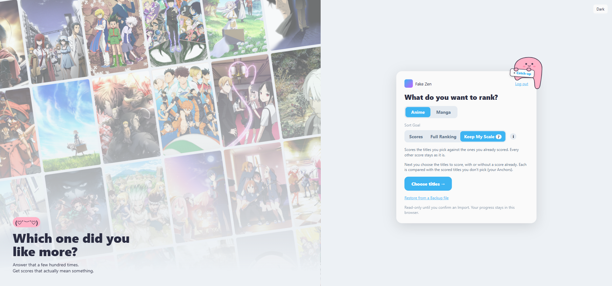
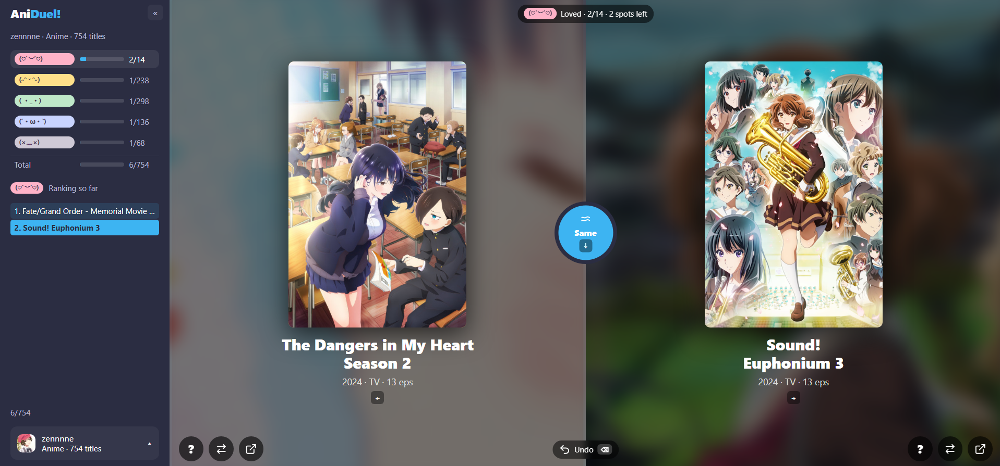
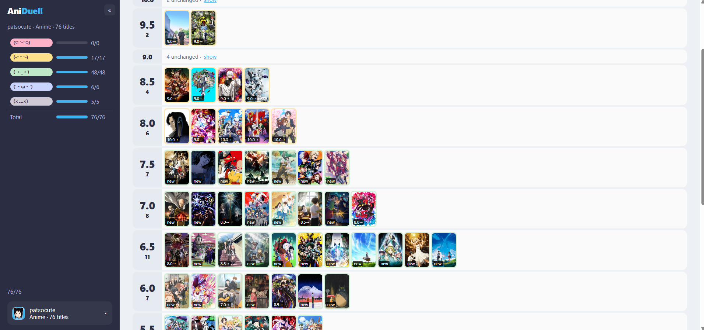
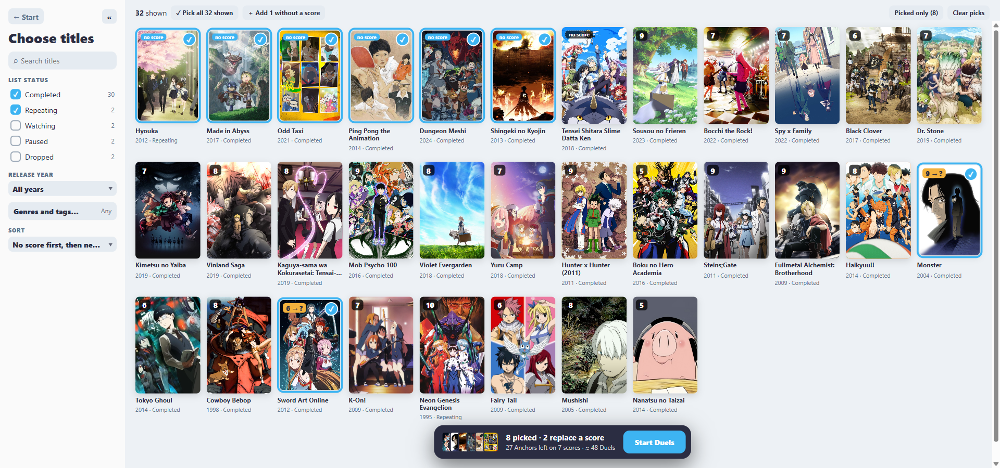
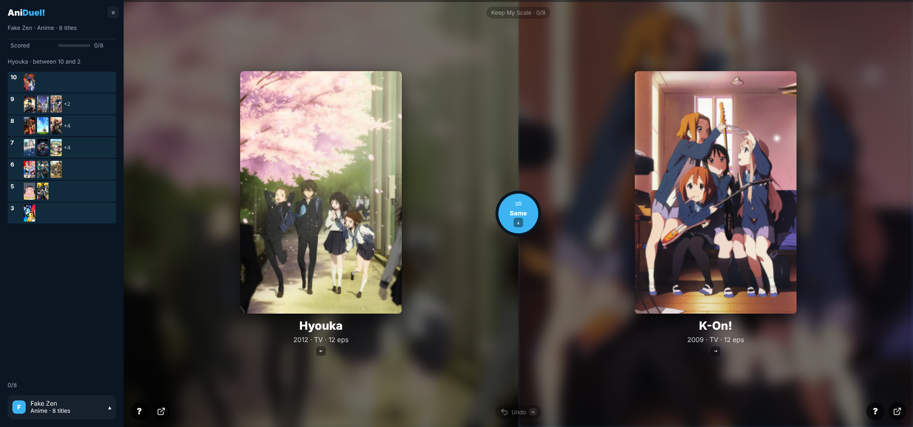
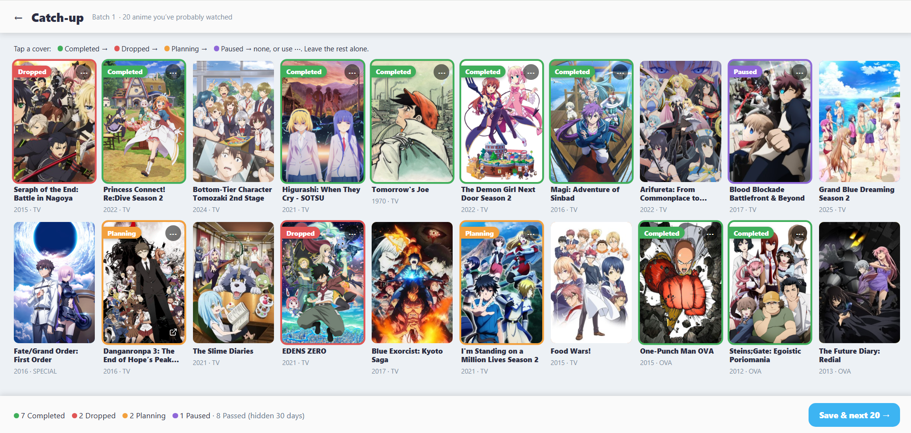

# AniDuel!

Build your AniList scores by comparing titles from your own list two at a time, then write the new scores back to AniList.

**Live:** https://zennnne.github.io/aniduel/

## Three ways to use it

You pick a **Sort Goal** when a Ranking starts.

| Sort Goal | Pick it when | Duels stop when |
| --- | --- | --- |
| **Scores** | you just want new scores on AniList | every title's score is settled |
| **Full Ranking** | you also want an exact order of your titles | every title has its own place |
| [**Keep My Scale**](#keep-my-scale) | you like the scores you have and only want to score the titles you pick | every picked title has a score |

Scores and Full Ranking rebuild every score from scratch and share the steps below. The default is Full Ranking for a Pool under 100 titles and Scores from 100 up (always Scores on the 10 point, 5 star and 3 smiley formats, where both give the same scores), and you can switch between the two at any time without losing answers. Keep My Scale works differently and is described in [its own section](#keep-my-scale).

Titles missing from your list? [**Catch-up**](#catch-up) (anime only) suggests anime you have probably watched, so you can add them before you rank.


*Start: pick a Media Type and a Sort Goal. With Keep My Scale selected, the next step is choosing the titles.*

## How it works

1. **Log in** with AniList. Pick a Media Type (Anime or Manga), which list statuses go into the **Pool**, and a Sort Goal.
2. **Rough Sort** — put each title into one of five **Bands** with a single tap.
   - Or use **Rough Sort from Scores**: titles that already have an AniList score go into a Band by how far that score sits from your own average, and only unscored titles are sorted by hand.
   - Oversized Bands can be split into three **Sub-bands**.
3. **Board** — see every title grouped into its Band and drag any title to another Band. Open during Rough Sort and once more as a last check before the first Duel.
4. **Duel** — pick the better of two titles from the same Band, call them equal (they share a **Tier**), or mark one **Forgotten**. Every answer can be undone.
5. **Preview** — see every title's old and new score, move or **Re-rank** titles, and tick which ones to write. Three settings shape the scores:
   - the best and worst score
   - the **Distribution**: Linear or Bell
   - the **Score Step**: fine, or human steps like every 0.5 / every 5
6. **Import** — write the chosen scores back to your AniList list (throttled, resumable, retries on rate limits).


*A Duel: pick the better title, or call them the same. The sidebar shows each Band's progress and the Ranking so far.*


*Preview: every title under its new score, with the old score on its cover, before anything is written.*

Progress is saved in your browser. Use **Backup** / **Restore** to move a Ranking to another browser. The Pool syncs with AniList when you come back, so added or removed titles are picked up.

See [GLOSSARY.md](GLOSSARY.md) for the exact meaning of each term.

### Scores or Full Ranking?

| | **Scores** | **Full Ranking** |
| --- | --- | --- |
| Default | from 100 titles, and at any size on the 10 point, 5 star and 3 smiley formats | under 100 titles, on the 100 point and 10 point decimal formats only |
| Duels stop when | every title's score is settled | every title has its own place |
| Titles with the same score | grouped, no order among them (sorted by name) | each in its own place, or a Tier if you called them equal |
| Score Step | whole points only (every 1 on 10 points with decimals, every 10 on 100 points) | fine (every level) or human (every 0.5 / every 5); the other formats have one step, so the scores match Scores |
| Duels needed | about 30–40% fewer than Full Ranking (200 titles, whole points) | about 1,000 for 200 titles |
| Changing best/worst or Distribution later | costs Refine Duels (roughly 50–120) before the affected titles can be imported | free: the order is already complete |

Under Scores, two more things differ:

- A change that moves a score boundary (settings, sync, Forgotten, a Band move, Re-rank) asks a few **Refine Duels** to settle the titles it affected.
- Preview groups titles by score level, and only settled titles can be ticked.

Switching keeps every answer. Switching to Full Ranking first shows about how many more Duels it will take.

### Keep My Scale

For when you already have a scoring scale and don't want it changed. You pick the titles to score in the **Picker**: titles without a score, and titles whose score you no longer trust. Every other title with an AniList score is an **Anchor**: a fixed reference point whose score is never touched. Each picked title is put through Duels against Anchors only, and gets the score of the Anchors it sits among; its old score plays no part.

**The Picker**

- Lists every title on your list except Planning ones, as a wall of covers with each title's score, release year and list status.
- Search, filter by list status, release year, genres and tags, and sort. Titles you picked stay picked when a filter hides them.
- **Add N without a score** picks every unscored title the filters show; **Pick all N shown** picks everything shown, search included.
- The dock at the bottom shows how many titles you picked, how many Anchors and scores they leave, and about how many Duels they take. It won't start with fewer than 20 Anchors on 3 scores.
- Titles left unsettled when a Keep My Scale Ranking ends are offered again the next time you open the Picker.


*The Picker: picked titles are ringed in blue; a picked title that already has a score reads `9 → ?`, since its score will be replaced.*

**When you can use it**

- Offered on Start when your list has at least 20 titles with a score, on at least 3 different scores.
- It can only be chosen when a Ranking starts, and can't be switched with the other two Sort Goals.

**How it differs from the steps above**

- No Rough Sort, Board or Bands: Duels start straight away, always a title being scored against an Anchor.
- A score boundary is passed only when two different Anchors agree.
- A title that beats one Anchor of a score and loses to another meets a third (or, on a score with only two Anchors, one Anchor of each neighbouring score). If it then ends up next to that score, it gets that score without being asked.
- A title that beats every Anchor of one score and loses to every Anchor of the next gets a one-off **Closer-to prompt**: which of the two scores is it closer to.
- An Anchor whose own score is contradicted by at least two titles, and by most of the titles settled against it, becomes a **Suspect Anchor**. It stops being used as a reference and is listed on Preview.
- Preview opens as soon as one title is settled, so you can import some scores without finishing the rest.
- The Ranking ends with its Import. Picked titles not yet settled can be picked again next time and start fresh, against Anchors that now include the ones just imported.


*Keep My Scale: each Duel puts a picked title against an Anchor. The sidebar shows the Anchors by score and where the title can still land.*

### Catch-up

**Catch-up** shows anime you have probably already watched and lets you add them to your list quickly. Anime only, opened from Start or the menu.

It is not only for a new AniList account. Use it to:

- fill in a list that is too thin to rank
- bring back titles you watched years ago and forgot to add
- record the ones you started and never finished, as Paused or Dropped
- find something to watch next and mark it Planning

How it works:

- **What it suggests:** 20 anime at a time, picked from the sequels, prequels and community recommendations of what is on your list, plus popular titles from the years and formats you watch.
- **What you do:** mark each one Completed, Dropped, Planning or Paused, then save to get the next batch. Saves are written to AniList in the background.
- **Titles you leave unmarked** are **Passed** and aren't suggested again for 30 days.
- **With a near-empty list**, Catch-up first asks roughly when you started watching anime.
- **When you are done**, it offers to go on to Keep My Scale if you qualify, with every unscored Completed and Repeating title already picked in the Picker, or to your default Sort Goal if not.


*Catch-up: tap a cover to mark it; unmarked titles are Passed for 30 days.*

So if you already have a scoring scale of your own, the two make a full loop: Catch-up adds the titles you have watched, then Keep My Scale gives them scores without changing the ones you already have.

## Development

Requires Node 22+.

```sh
npm install
npm run dev        # http://localhost:5173/aniduel/
```

| Script | What it does |
| --- | --- |
| `npm run dev` | Vite dev server |
| `npm test` | Run tests once (Vitest) |
| `npm run test:watch` | Tests in watch mode |
| `npm run lint` | oxlint |
| `npm run typecheck` | `tsc -b` |
| `npm run build` | Typecheck and build to `dist/` |
| `npm run preview` | Serve the built `dist/` |
| `npm run eval:catchup` | Holdout eval used to choose the Catch-up suggestion weights |
| `npm run eval:keep-my-scale` | Simulated-user eval of the Keep My Scale placement rules; run it before and after changing one |

To see a screen without an AniList login, open `http://localhost:5173/aniduel/?fake-anilist`: the app signed in against a fake AniList with a fixed list (`src/dev/fakeSession.ts`). Dev server only, and every page load starts fresh.

Login uses AniList's OAuth implicit grant. Two AniList API clients are registered in `src/config.ts`: one for production (`https://zennnne.github.io/aniduel/`) and one for local dev (`http://localhost:5173/aniduel/`). The redirect URL must match exactly, so run the dev server on port 5173.

## Project layout

```
src/
  anilist/      AniList GraphQL gateway and types
  auth/         OAuth token handling
  pool/         Building the Pool, picking Anchors, and syncing with AniList
  ranking/      Ranking engine (replays the Duel log), Sort Goal, scoring, Sub-band split,
                Rough Sort from Scores, Keep My Scale, Refine Duel estimates, Preview
  catchup/      Catch-up suggestions, batches, Passed titles, starting era, exit offer
  import/       Import plan and state
  writes/       Write queue and rate limiter shared by Import (scores) and Catch-up (list statuses)
  persistence/  Saved progress, Backup files, and the titles a Keep My Scale Ranking left unsettled
  dev/          Dev-only fake AniList session (`?fake-anilist`)
  ui/           React screens (Start, Picker, Rough Sort, Board, Band choice, Duel, Split, Preview, Import, Catch-up)
scripts/        Catch-up holdout eval and Keep My Scale simulated-user eval
docs/adr/       Architecture decision records
docs/research/  Research behind the Catch-up suggestions and Keep My Scale scoring
```

Key design decisions:

- [ADR 0001](docs/adr/0001-duel-log-as-source-of-truth.md) — The Duel log is the source of truth; the Ranking is rebuilt by replaying it.
- [ADR 0002](docs/adr/0002-bands-order-only-with-band-score-ranges.md) — Bands decide order only; the Distribution decides scores.
- [ADR 0003](docs/adr/0003-calculate-scores-at-score-format-levels.md) — Scores are calculated at the user's Score Format levels.
- [ADR 0004](docs/adr/0004-no-router-on-github-pages.md) — No client-side router; screens are driven by app state.
- [ADR 0005](docs/adr/0005-duel-log-is-never-rewritten.md) — The Duel log is never rewritten.
- [ADR 0006](docs/adr/0006-split-oversized-bands-into-sub-bands.md) — Oversized Bands split into three Sub-bands.
- [ADR 0007](docs/adr/0007-sort-goal-scores-with-settings-in-the-duel-log.md) — Sort Goal: Scores or Full Ranking (the default follows the Pool size and the Score Format), with scoring settings in the Duel log.
- [ADR 0008](docs/adr/0008-rough-sort-from-scores-as-one-event.md) — Rough Sort from Scores is one event that carries every Band choice.
- [ADR 0009](docs/adr/0009-score-new-titles-against-anchors.md) — Keep My Scale: a third Sort Goal that scores titles against fixed Anchors.
- [ADR 0010](docs/adr/0010-score-new-titles-ends-with-its-import.md) — A Keep My Scale Ranking ends with its Import.
- [ADR 0011](docs/adr/0011-keep-my-scale-a-hand-picked-pool.md) — Keep My Scale: the name of the third Sort Goal, and a Pool picked by hand.
- [ADR 0012](docs/adr/0012-keep-my-scale-a-split-on-a-score-is-not-asked.md) — Keep My Scale: a title split on a score gets that score instead of the Closer-to prompt.
- [ADR 0013](docs/adr/0013-keep-my-scale-deciding-duels-before-the-closer-to-prompt.md) — Keep My Scale: Deciding Duels before the Closer-to prompt, as the user's choice.

## Deployment

Every push runs CI (lint, test, build). Pushes to `main` also deploy `dist/` to GitHub Pages.
